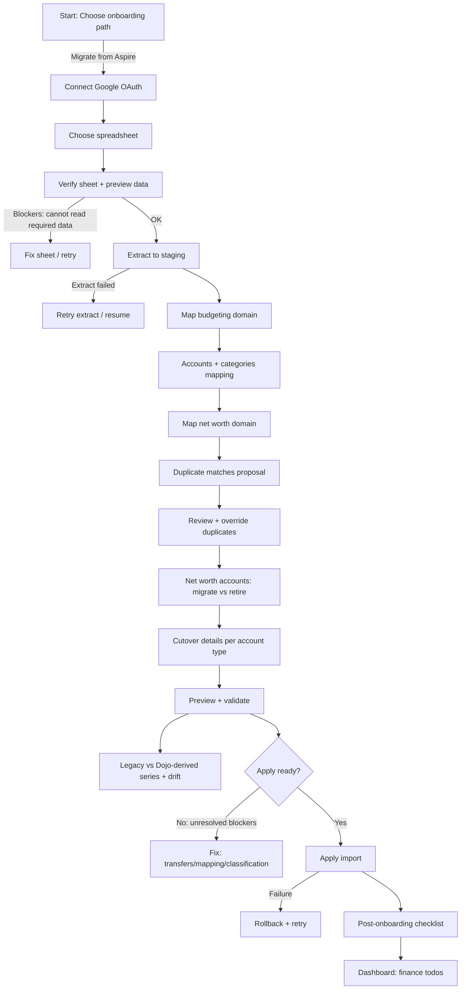
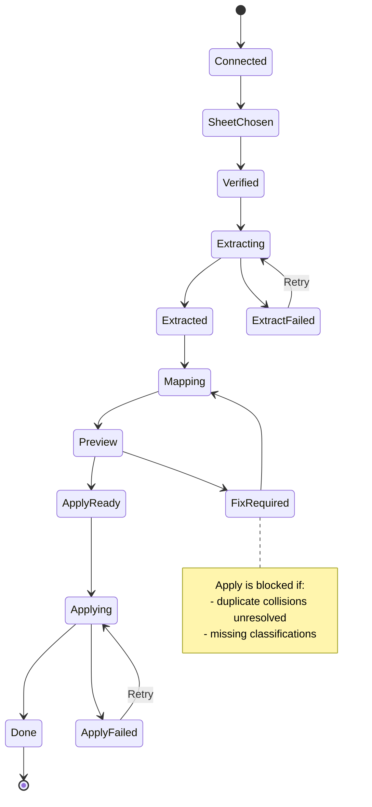

# Aspire Migration Onboarding UX Map (Dojo)

Status: Draft

This document is a UX handoff artifact for designing the Aspire -> Dojo onboarding wizard.
It defines the end-to-end user journey, screen inventory, decision points, failure states,
and accessibility requirements.

Constraints:

- This document is self-contained and can be shared with UX/frontend designers.
- This flow reflects the intended Aspire migration semantics and onboarding behaviors described in the RFC.
  It intentionally does not describe the current code implementation.
- This is a one-time onboarding wizard for users opting into Aspire migration.
- The backend may persist resumable state as a "migration session"; the UX should treat this as "resume onboarding".

## 1) Problem definition

Aspire stores budgeting (ledger + allocations) and net worth (explicit monthly marks) as separate sources.
Dojo aims to derive net worth from one consistent model: ledger cashflows + measurement commits (reconcile/valuations).

The migration must:

- preserve years of Aspire net worth history,
- avoid double counting (no shadow net worth accounts for transaction-backed balances),
- remain trustworthy via drift previews and explicit checkpoints,
- and be low-friction enough that users finish it.

## 2) Target users and jobs

Primary persona: Aspire power user

- Has years of history.
- Uses frequent transaction entry (often weekly), budget allocations when money hits accounts (often 1-2 times/month),
  and net worth updates at the beginning of the month.
- Expects credit card payment reserve behavior.
- Wants net worth continuity (year-over-year charts) and more granular tracking going forward.

Jobs to be done:

- "Bring my Aspire history into Dojo without breaking my numbers."
- "Ensure duplicates (checking/credit) are not double-counted."
- "Set up a few accounts (investments/loan) for better tracking going forward, without backfilling."
- "Finish quickly, and know what I need to reconcile next."

## 3) Non-negotiable UX invariants (from RFC)

- No double counting.
- No fabricated money to force continuity.
- Transfers are net worth neutral (no orphan transfer legs).
- History includes retired/inactive entities (as-of correct).
- Investment ledger purity: deposits/withdrawals only; internal activity stays out of the ledger.

## 4) Information architecture

Entry points

- First-run onboarding: "Migrate from Aspire"
- Settings (pre-onboarding only): optionally offer "Restart onboarding" (creates a new session)

Top-level navigation model

- Wizard is modal-based (consistent with Dojo patterns): a focused flow with a stepper header and a sticky footer.
- Users can safely leave and resume.

Session model (user mental model)

- "Resume onboarding" is presented as a single flow.
- Internally, progress is persisted by `migration_session_id` + dataset fingerprint.

## 5) End-to-end flow diagram

## 6) Screen inventory and user flow

Common layout (all steps)

- Stepper header: current step label + progress.
- Main content: one primary task per screen.
- Sticky footer:
  - Primary CTA (Continue / Apply import)
  - Secondary CTA (Back)
  - Tertiary CTA (Exit)
- Inline help panel: short, non-jargony explanations and "why" for trust.

Progress persistence (autosave)

- The wizard autosaves as the user makes decisions.
- Provide an always-visible status line: "Saved" / "Saving..." / "Offline".
- "Exit" closes the wizard and returns the user to a resume entry point.

### Step 1: Choose onboarding path

Purpose

- Set expectation that migration is resumable and safe.

UI

- Two tiles:
  - "Start fresh"
  - "Migrate from Aspire"

Primary CTA

- "Migrate from Aspire"

Accessibility

- Tiles are buttons with clear focus states and descriptive labels.

### Step 2: Connect Google OAuth

Purpose

- Grant read access to Sheets.

System behavior

- Explain privacy: tokens in memory only; not written to disk/DB.

Failure states

- OAuth failed / expired: show retry, and a link to setup docs.

Primary CTA

- "Connect Google"

### Step 3: Choose spreadsheet

Purpose

- Select which Aspire workbook to read.

UI

- Primary input: paste spreadsheet URL.
- Optional: "Browse Google Drive" (only if the OAuth scopes and API allow listing/picking files).
- Always show "How do I find my spreadsheet URL?" helper.

Primary CTA

- "Use this spreadsheet"

### Step 4: Verify sheet + preview data

Purpose

- Ensure the workbook is readable and looks like an Aspire dataset.

User-facing principle:

- Users should not need to understand sheet implementation details.
- We validate the sheet structure behind the scenes.
- We only mention implementation details if something is wrong and the user needs help fixing it.

UI

- A simple "We found" preview card (safe to show):
  - Budget accounts: count
  - Credit cards: count
  - Budget categories: count
  - Transactions: count + date range
  - Allocations: count + date range
  - Net worth entries: count + date range
- If validation fails, show a "Needs attention" panel:
  - What Dojo couldn't read (in plain language)
  - What the user can do (steps)
  - Advanced details toggle (implementation diagnostics, including named range names)

Primary CTA

- "Extract data"

### Step 5: Extract to staging

Purpose

- Create a snapshot of the sheet into Dojo staging tables.

UI

- Progress indicator.
- Summary after completion (counts + date ranges only):
  - transactions count + min/max date
  - allocations count + min/max date
  - net worth marks count + min/max date

Privacy guardrail

- It is acceptable to show real user data in the UI (this is a personal finance app).
  However, the system must ensure this data never reaches logs.
  - Avoid logging payloads.
  - Avoid logging raw rows in error messages.
  - Prefer redacted diagnostics exports (counts, date ranges, category/account names only).

Primary CTA

- "Continue"

### Step 6: Map budgeting domain

Purpose

- Create/confirm Dojo budget accounts and budget categories required to import the ledger.

Substep 6.1 Accounts

- Label this section explicitly as "Budget accounts".
- Default classification:
  - bank/cash accounts -> cash, on_budget
  - credit cards -> credit, on_budget
- Preserve hidden Aspire accounts by importing them as "Retired" in Dojo.
- Users can rename, retire, or set tracking/off-budget for specific accounts (advanced).

Substep 6.2 Categories

- Import user categories + groups.
- Respect hidden/retired lists.
- System categories are not created from user labels.

Substep 6.3 Transfers (informational)

Why this exists

- Aspire represents transfers using a special transfer category label.
- In real data, the two sides of a transfer often do not share the exact same date (one side can post the next day).

Design decision (migration)

- Dojo should auto-pair Aspire transfer legs when it can do so deterministically.
  - Heuristic: same absolute amount, different accounts, and within a small date tolerance window (start with +/- 3 days).
  - When paired, Dojo imports them as a single transfer with linked legs.
- Dojo should not present a manual pairing UI.
  - If a leg cannot be paired deterministically, it becomes a "transfer exception" that must be resolved by classification (see below).
  - This keeps the wizard low-friction while still preventing orphan legs from entering the committed ledger.

UI pattern

- Summary card:
  - "Transfer-type transactions detected: N"
  - "Auto-paired transfers: P" (with the date tolerance used)
  - "Transfer exceptions: E" (requires review)
  - "Transfers do not count as spending."

Transfer exceptions (blocking)

- Show a compact list of exception rows (date, account, amount, memo).
- For each exception, the user must choose one:
  - "This is an external inflow/outflow" (pick a real budget category)
  - "This is a balance correction" (mapped to Opening Balance / Balance Adjustment)
  - "Ignore" is not allowed if it would change balances; the user must classify.

Primary CTA

- "Continue"

### Step 7: Map net worth domain

Purpose

- Migrate Aspire net worth accounts into Dojo in a way that:
  - preserves legacy net worth history,
  - avoids double counting duplicates,
  - and streamlines handoff into Dojo accounts for ongoing tracking.

Substep 7.1 Duplicate mapping proposal

- Dojo proposes matches between net worth categories and transaction accounts.
  - Exact normalized match is the first pass.
  - Fuzzy suggestions are shown only as suggestions and require explicit confirmation.
  - Collisions (multiple candidates) must be resolved by the user.

Default for duplicates

- Legacy marks are kept as checkpoints.
- Dojo-derived net worth uses the ledger-derived account balance (marks not added).

UI

- Mapping table with columns:
  - Aspire net worth category
  - Proposed Dojo account
  - Match reason
  - Drift preview (sparkline + stats)
  - Override action

Substep 7.2 Net worth accounts: migrate vs retire

Defaults

- Default action is "Migrate".
- Users "Retire" only what they no longer have (paid-off loans, sold tangibles, closed accounts).
- If an account is hidden/retired in Aspire, default to Retire.

Use verbs that match the mental model

- "Migrate" (track forward in Dojo)
- "Retire" (historical only)

If user chooses "Migrate"

Handoff workspace (critical UX focus)

- This is the core value moment of the wizard.
- The UI should be optimized for rapid creation of new Dojo accounts and immediate validation.

Key interactions

1) For each Aspire net worth account, choose:
  - Migrate (default) or Retire
2) If Migrate:
  - Choose Dojo account type: investment, loan/mortgage, tangible
  - Create destination Dojo account(s) inline
    - Support split cutover: one Aspire entity -> multiple Dojo accounts
  - Enter cutover statement values (reconcile inputs)
  - See an immediate continuity check (before leaving this substep)

Immediate validation (do not wait until end of wizard)

- After each migrated account is configured, show:
  - "Legacy value (latest Aspire mark): {date, value}"
  - "Cutover statement value: {date, value}"
  - "Drift recorded at cutover: +/- X" (expected if Aspire is stale)
  - "Net worth continuity: OK / Needs attention"

Design note: Aspire staleness

- Users may not have updated Aspire net worth marks recently.
- The wizard must not force the user to update Aspire first.
- Provide a helpful recommendation:
  - "If you want smaller drift, update your Aspire net worth tab before migrating. Otherwise, we will record drift and your new accounts will start from your statement values."

Substep 7.3 Cutover details (progressive disclosure)

Global

- Cutover date default: today (editable)
- Cutover value: statement as-of value
- Any mismatch is recorded as drift (not plugged)

Investment cutover inputs

- Statement date
- Statement cash (uninvested)
- Holdings list (ticker, quantity, avg cost/cost basis)

Loan cutover inputs

- Statement principal
- Interest rate
- Start date + original term
- Original principal
- Choose tracking mode:
  - Mode A (default): statement principal checkpoints
  - Mode B (advanced): split payments

Tangible cutover inputs

- Value + date
- Provenance (recommended)

Primary CTA

- "Continue"

### Step 8: Preview + validate

Purpose

- Build trust before committing changes.

What to show

1) Net worth charts (side-by-side)

- "Aspire history (monthly snapshots)" (bucket semantics)
- "Dojo view (derived)" (as-of semantics)

2) Drift framing

- Expected differences: bucket vs as-of, date-only ordering.
- Drift is not used as a hard blocker. It is a confidence signal.
  - The ultimate trust mechanism is per-account reconciliation to statements.
  - This preview exists to show that Dojo-derived totals are roughly aligned to Aspire history.

3) Budget parity (trust check)

Purpose:

- Catch "suddenly more/less money in buckets" before apply.
- Validate that Dojo's envelope math matches what the user sees in Aspire.

Approach:

- Dojo computes Aspire-derived expectations from the extracted records (transactions + allocations) and compares them to Dojo's post-import month state.
- Optionally (if we can identify stable named ranges for Aspire dashboard headline cells), also show "Aspire Dashboard" values for the same extraction date as an additional trust anchor.
  If not available, label the expectations clearly as "Derived from extracted Aspire records".

Headline parity (current month):

- Ready to Assign
- Budgeted this month
- Spent this month
- Optional: pending transaction count (informational)

Category-level parity:

- Show a table for the current month with:
  - Category
  - Expected available (Aspire-derived)
  - Dojo available
  - Diff
- Default to showing only categories with diffs (and allow "Show all").

Important disclosure:

- Aspire carries envelope balances forward month-to-month (including negative availability) unless you explicitly reallocate.
  Dojo should do the same.
  If this check shows unexpected differences, common causes are:
  - pending/cleared status inclusion differences,
  - break-marker rows accidentally treated as money movement,
  - or transfer exceptions that were classified differently.

3) Blocking checklist for apply

- Duplicate mapping collisions
- Net worth categories included in Dojo-derived totals but missing asset/debt classification

Primary CTA

- "Apply import" (disabled until blockers cleared)

Secondary CTA

- "Fix issues" navigates directly to the blocking substep.

Accessibility

- Charts must have text equivalents (table summary, key stats).

### Step 9: Apply import

Purpose

- Commit the import as one transactional operation.

UI

- Confirmation screen that lists:
  - what will be created (counts + date ranges)
  - what will not happen:
    - no fabricated money
    - no tokens stored
    - duplicates will not be double counted

Failure states

- Apply failed: show rollback confirmation and a single "Retry".

Primary CTA

- "Apply import"

### Step 10: Post-onboarding checklist

Purpose

- Convert the user from migration mode into steady-state maintenance.

UI

- A short ordered list:
  1) Reconcile cash accounts
  2) Reconcile credit cards
  3) Update loan principal checkpoint (Mode A) if enabled
  4) Reconcile investments (holdings + statement cash)

Dashboard integration

- These become persistent "finance todos".

Primary CTA

- "Go to dashboard"

## 7) Failure states and recovery map

## 8) Component inventory (for mockups)

This is a suggested component list to keep mockups implementable.
If an equivalent component exists in Dojo, reuse it; otherwise design a new one with matching patterns.

- Wizard shell
  - Stepper header
  - Sticky footer (primary/secondary/tertiary CTAs)
  - Save + resume banner

- Tables
  - Duplicate mapping table (match reason + drift preview)
  - Cutover split table (sum validation)

- Charts
  - Dual net worth chart (legacy vs derived)
  - Drift sparkline per duplicate mapping row

- Forms
  - Investment holdings editor (table-style input)
  - Loan principal checkpoint form
  - Tangible valuation form

- Feedback
  - Inline validation messages
  - Non-blocking warnings vs blocking errors
  - Apply confirmation "commit" card

## 9) Visual style and brand alignment

This wizard should match Dojo's visual direction: "Minimalist Earth Tones".

Philosophy

- Minimalism: every element has a purpose; avoid decorative UI.
- Functionality: intuitive and fast; emphasize trust.
- Content-focused: data and actions first.

Color tokens (hex)

- Primary: `#3D2B1F` (dark brown) for primary actions and headings.
- Secondary: `#8F7C6A` (muted brown) for secondary actions and borders.
- Accent: `#5F7161` (muted green) for highlights and selected states.
- Background: `#FDFBF7` (off-white).
- Text: `#2A2A2A` (charcoal).

Components

- Buttons:
  - Primary: solid `#3D2B1F` with light text.
  - Secondary: outlined `#8F7C6A` with dark text.
  - Hover/active: use accent `#5F7161`.
- Forms:
  - Inputs: simple, underlined inputs.
  - Focus state: accent color.
  - Labels above inputs.
- Separation:
  - Use borders, not shadows.

Layout

- Use an 8px spacing scale.
- Use generous whitespace; reduce visual noise.

Motion

- Meaningful transitions only:
  - step transitions,
  - resolving an exception row,
  - apply success.

## 10) Accessibility requirements (WCAG 2.1 AA)

- Wizard is fully keyboard navigable.
  - Focus is trapped within the modal wizard.
  - Step transitions move focus to the step heading.

- All form fields:
  - have visible labels (no placeholder-only)
  - provide error messages linked via `aria-describedby`
  - use inline error summaries on apply-blocking steps

- Tables:
  - use semantic table markup in web implementation
  - row actions are reachable and have clear names

- Charts:
  - provide text alternatives (summary + downloadable table)
  - do not rely on color only; include patterns/markers

- Contrast:
  - meet AA contrast for text and interactive elements.

## 11) Frontend implementation guidance (non-binding)

The UX team can mock freely, but it helps to design with likely SPA constraints.

- The wizard should be a route-backed modal.
  - URL encodes the step (supports refresh/resume).
  - Session id is stored client-side and validated server-side.

Implementation-agnostic architecture assumptions (for mockups)

- Single-page app (SPA) with a client router.
- Component-based UI.
- Backend-driven persistence for the migration session (autosave).
- Clear mutation boundaries:
  - extract
  - apply
  - reconcile (for cutover tracking)

- Query/mutation patterns
  - Treat extraction, mapping saves, and apply as explicit mutations with clear loading/error states.
  - Ensure optimistic UI is used only for local mapping edits; apply remains server-confirmed.

- Progressive disclosure
  - Default selections minimize user choices.
  - Expand advanced options (loan Mode B, split cutover) behind an "Advanced" toggle.

## 12) Open questions (explicit buy-in points)

These require product decisions before mockups finalize.

1) Spreadsheet selection UX
   - Do we support a Google file picker (browse), or only paste-a-link?

2) Transfer exception review
   - Decision: no transfer leg matching in the wizard.
   - Open: do we want a post-import optional report for "transfer-like transactions that appear one-sided" (non-blocking)?

3) Drift thresholds
   - Default date tolerance window for drift comparisons (e.g., +/- 3 days).
   - Default amount threshold for actionable drift.

4) Net worth account migration defaults
   - This UX map assumes default = "Migrate" for active net worth accounts and "Retire" only for closed/sold/paid-off items.
   - Confirm this default is desired for Aspire migrators.
